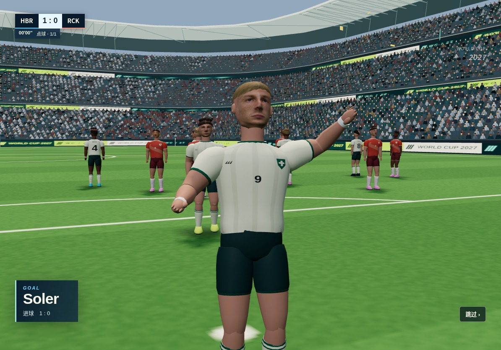

# World Cup 2027

iPad 横屏离线足球游戏 · 0.3.0

## 下载

- [直接下载 v0.3.0 IPA](https://github.com/haahhushs-alt/World-Cup-2027/raw/refs/heads/main/downloads/WorldCup2027-v0.3.0.ipa)
- [下载同版 ZIP 压缩包](https://github.com/haahhushs-alt/World-Cup-2027/raw/refs/heads/main/downloads/WorldCup2027-download.zip)

请使用 Safari 打开下载链接。IPA 未签名，需要通过自己的签名方式安装到 iPad。

## v0.3.0 更新

- 球员模型使用四张原创人脸纹理，重新塑造眉骨、鼻梁、下颌与发际线。近景能看到发丝、球衣接缝、鞋钉和手部细节。肘膝附近的网格会随关节弯曲。
- 跑步、触球声和球的位置共用步点。普通传球时队友会迎球，直塞时跑向前方空间。按住冲刺并大幅改变摇杆方向可手动接管接球路线。一脚出球会保留按键时的瞄准方向。
- 左下区域可以唤出虚拟摇杆。手柄 B 默认按住蓄力、松开射门，键位可改。转播镜头在长传时拉宽，进球后跟拍庆祝，并在回放中重现球网形变。
- 新增带球轻触、撞网和擦门而过时的看台声，现有 18 组离线音频。

[点球、庆祝与回放视频](previews/penalty-v0.3.0.mp4)

## v0.2.2 更新

可以在接球前预先按传球或射门，触球时立即出球。进球回放固定从对应球门后方播放。

## v0.2.1 更新

接球时，球在约 0.18 秒内从触球点过渡到脚边，并播放轻触球音效。转播镜头会根据球速和进攻方向提前跟进。

## v0.2 更新

15组原创合成音频包含观众底噪、助威、触球、射门、抢断、扑救、脚步、落地、门框、哨声、终场哨、音乐与界面反馈。声音保存在安装包中，离线可用。在设置或暂停菜单中分别调节总音量、观众、比赛音效和音乐。

比赛加入低角度转播镜头、动态阴影、雷达和射门力度条。带球步点和球员避让经过调整，防守时射门键切换为抢断、传球键切换为切人。射门按住蓄力，滑动切换脚法。保留手柄自定义键位和第一人称视角。

## 工程与验证

- `game/` 包含游戏代码和离线资源。
- `ios/` 包含 WKWebView 原生宿主及 Game Controller 桥接。
- macOS 安装 Xcode 后运行 `sh ios/scripts/package.sh`，或手动运行 Actions 工作流。
- `node tools/check-match.cjs` 验证 63 种传接球组合、预输入方向、截球和点球回放。
- `tools/create-audio.py` 生成音频，依赖 Python、NumPy、SciPy 和 ffmpeg。

已验证模拟全场比赛、进球回放、滑动手势、改键、音频解码、音量保存以及静音。IPA 的 arm64 架构、版本号、未签名状态与资源完整性已核对。

当前为独立足球游戏原型，人物与动作质量仍有提升空间。iPadOS 26.0.1 与黑武士3 Pro 的实际安装和连接尚待真机测试，规则覆盖主要判罚。
