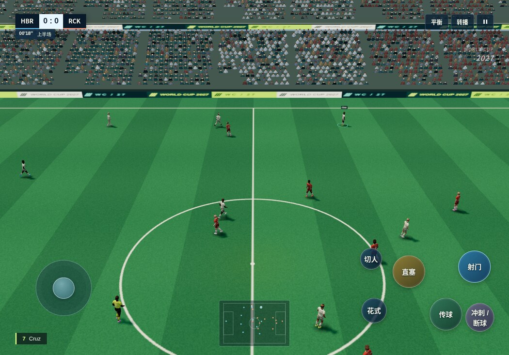

# World Cup 2027

iPad 横屏离线足球游戏 · 0.2.0

## 下载

- [直接下载 v0.2 IPA](https://github.com/haahhushs-alt/World-Cup-2027/raw/refs/heads/main/downloads/WorldCup2027-v0.2.ipa)
- [下载 ZIP 压缩包](https://github.com/haahhushs-alt/World-Cup-2027/raw/refs/heads/main/downloads/WorldCup2027-download.zip)

请使用 Safari 打开下载链接。IPA 未签名，需要通过自己的签名方式安装到 iPad。

## 本次更新

15组原创合成音频包含观众底噪、助威、触球、射门、抢断、扑救、脚步、落地、门框、哨声、终场哨、音乐与界面反馈。声音保存在安装包中，离线可用。在设置或暂停菜单中分别调节总音量、观众、比赛音效和音乐。

比赛加入低角度转播镜头、动态阴影、雷达和射门力度条。带球步点和球员避让经过调整，防守时射门键切换为抢断、传球键切换为切人。射门按住蓄力，滑动切换脚法。保留手柄自定义键位和第一人称视角。

## 工程与验证

- `game/` 包含游戏代码和离线资源。
- `ios/` 包含 WKWebView 原生宿主及 Game Controller 桥接。
- macOS 安装 Xcode 后运行 `sh ios/scripts/package.sh`，或手动运行 Actions 工作流。
- `tools/create-audio.py` 生成音频，依赖 Python、NumPy、SciPy 和 ffmpeg。

已验证模拟全场比赛、进球回放、滑动手势、改键、音频解码、音量保存以及静音。IPA 的 arm64 架构、版本号、未签名状态与资源完整性已核对。

当前为独立足球游戏原型，人物与动作质量仍有提升空间。iPadOS 26.0.1 与黑武士3 Pro 的实际安装和连接尚待真机测试，规则覆盖主要判罚。
